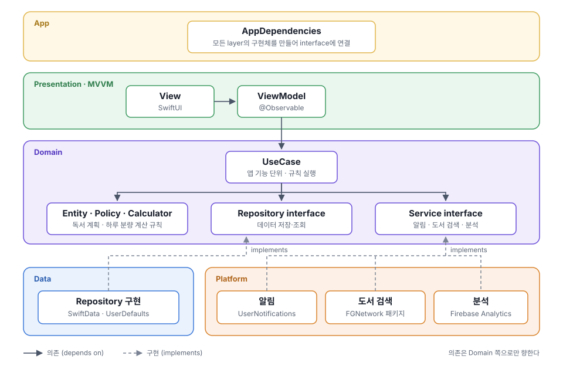

# 한입독서 · Read a Bite

목표일까지 하루에 읽을 분량을 나눠 주고, 매일 읽도록 알려 주는 iOS 독서 앱
*An iOS app that splits a reading goal into daily pages and reminds you to read.*

[App Store](https://apps.apple.com/kr/app/%ED%95%9C%EC%9E%85%EB%8F%85%EC%84%9C-read-a-bite/id6738048252)

## 어떤 서비스인가요

"하루 한 입씩, 부담 없이 완독까지"를 돕는 앱입니다. 읽을 책과 목표일을 정하면 하루 분량을 계산해 주고, 그날 읽은 만큼 기록하면 남은 분량을 남은 날짜에 다시 나눠 줍니다.

- **하루 분량 계산:** 목표일까지 하루에 읽을 페이지를 나누고, 기록에 따라 다시 계산
- **독서 알림:** 계획을 세우고도 잊지 않도록 정한 시간에 알림
- **여러 권 함께 읽기:** 여러 책의 목표를 동시에 관리
- **도서 검색:** 카카오 검색·국립중앙도서관으로 책 정보 불러오기

Apple Developer Academy @ POSTECH 팀 프로젝트(PM 1 · 디자인 2 · iOS 2)입니다.

## 아키텍처

Feature 단위 **MVVM + Clean Architecture**입니다. 의존은 Domain 쪽으로만 향하고, 구현체 조립은 App이 맡습니다.

| 영역 | 기술 |
|---|---|
| UI | SwiftUI, Observation |
| 저장 | SwiftData, UserDefaults |
| 외부 연동 | UserNotifications, FGNetwork(로컬 Swift Package), Firebase Analytics |
| 품질 | Swift Testing, SwiftLint(커스텀 규칙으로 레이어 경계 검사), pre-push·CI |

레이어별 역할과 규칙은 [services/_common/architecture.md](services/_common/architecture.md)에 있습니다.

## 더 보기

| 목적 | 문서 |
|---|---|
| 빌드·테스트 시작하기 | [handbook/where/setup.md](handbook/where/setup.md) |
| 작업 규칙(사람·코딩 에이전트 공통) | [AGENTS.md](AGENTS.md) |
| 설계 결정과 이유 | [history/decisions](history/decisions) |
